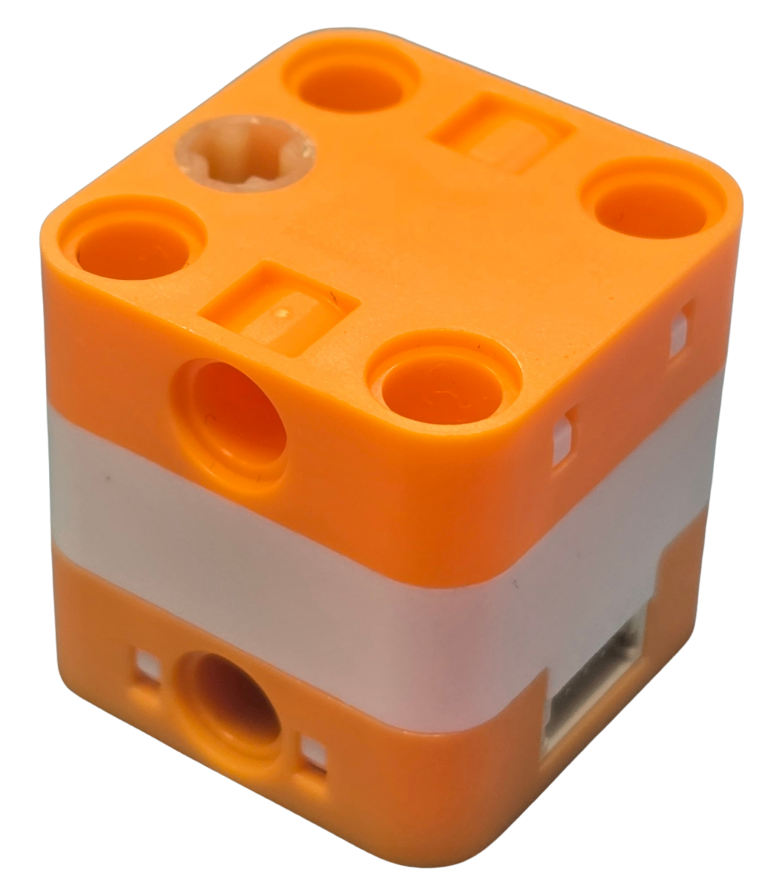
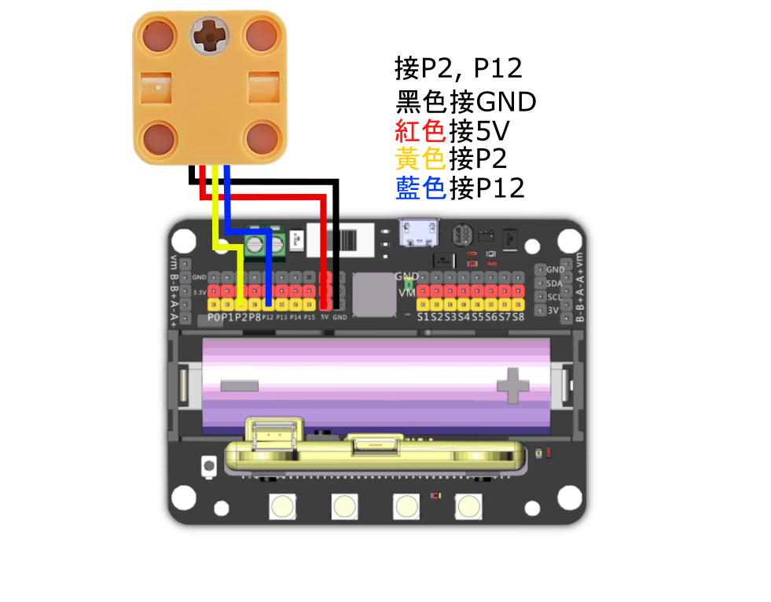

# Sugar 舵機馬達

<figure><figcaption></figcaption></figure>

Sugar 舵機馬達適用於需要精準控制角度的項目，例如無人車、智能轉盤及機械人關節。在比賽任務中，可用於控制機械人直線行駛，或按指定角度轉向。

## 產品參數：

* 尺寸：24 × 24 × 24 mm
* 通訊協議：4-pin 串口
* 工作電壓：5.0 V
* 結構特點：4 面設有 LEGO 插銷孔
* 最大速度：480°/秒

## 產品接線

#### Robotbit EDU

<figure><figcaption></figcaption></figure>

#### Robotbit 2.2

<figure><figcaption></figcaption></figure>

## 參考程式

#### MakeCode編程教學

#### 加載Sugar插件：

#### 在擴展頁直接搜尋sugar (sugar已經過微軟認證，可以直接搜尋)

#### 你亦可以用插件地址搜尋

Sugar插件：https://github.com/KittenBot/pxt-sugar

#### [詳細方法](../programmingplatforms/makecode/kittenbotandmakecode.md)

### 舵機馬達編程積木

<figure><figcaption></figcaption></figure>

### asdasd

[參考程式](https://makecode.microbit.org/_DdPiLTfM7Jk6)
