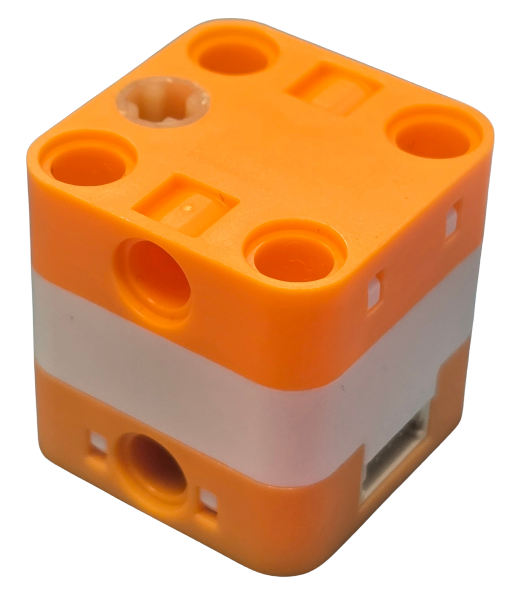
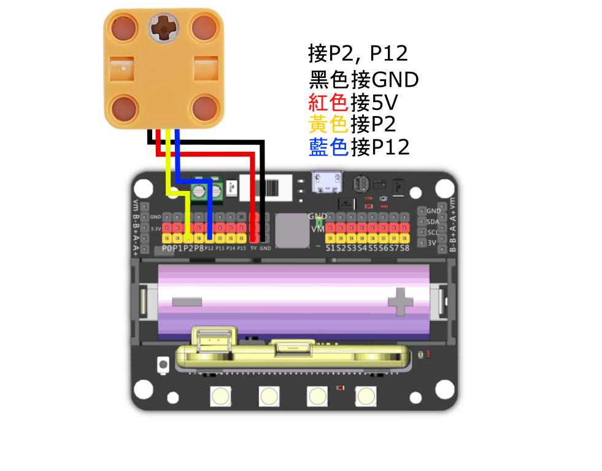

# Sugar 舵機馬達

<figure><figcaption></figcaption></figure>

Sugar 舵機馬達具備電機+舵機雙功能。適用於需要精準控制角度的項目，例如無人車、智能轉盤及機械人關節。在比賽任務中，可用於控制機械人直線行駛，或按指定角度轉向。

## 產品參數：

* 尺寸：24 × 24 × 24 mm
* 通訊協議：4-pin 串口
* 工作電壓：5.0 V
* 結構特點：4 面設有 LEGO 插銷孔
* 最大速度：480°/秒

## 產品接線

#### Robotbit EDU

<figure><figcaption></figcaption></figure>

#### Robotbit 2.2

<figure><figcaption></figcaption></figure>

### 串聯接線

Sugar 舵機馬達可以透過串聯接線將多個馬達連結起來，使用一個串口控制多個馬達。

<figure><figcaption></figcaption></figure>

## 參考程式

#### MakeCode編程教學

#### 加載Sugar插件：

#### 在擴展頁直接搜尋sugar (sugar已經過微軟認證，可以直接搜尋)

#### 你亦可以用插件地址搜尋

Sugar插件：https://github.com/KittenBot/pxt-sugar

#### [詳細方法](../programmingplatforms/makecode/kittenbotandmakecode.md)

### 舵機馬達編程積木

<figure><figcaption></figcaption></figure>

### Sugar 舵機馬達ID設定

每隻Sugar 舵機馬達可以設定ID，ID會儲存在馬達上。可以在編程透過ID單獨控制某個舵機。

設定時會將線上所有馬達都設定為該ID，如果需要每隻馬達設定不同ID，請每次只連接需要設定ID的馬達。

<figure><figcaption></figcaption></figure>

<figure><figcaption></figcaption></figure>



[參考程式](https://makecode.microbit.org/_gHxdmbdKA6iY)

### 電機模式



[參考程式](https://makecode.microbit.org/_29Xb9Pbip7rw)

### 舵機模式



[參考程式](https://makecode.microbit.org/_AbJ42k1UkfT4)

### 設定扭矩模式



[參考程式](https://makecode.microbit.org/_JaeetYHec0t6)

<figure><figcaption></figcaption></figure>

### 設定轉動模式



[參考程式](https://makecode.microbit.org/_WotafAa6Ka4K)

有關相對位置及絕對位置的說明可以參考以下圖示。

#### 相對位置

在相對模式下，舵機不會理會現時的角度，直接視轉動角度為幅度而轉動，會將指針按收到的角度去轉動。

<figure><figcaption></figcaption></figure>

#### 絕對模式

在絕對模式下，舵機會檢查現時角度，視轉動角度為終點角度，會將指針指往收到的角度。

<figure><figcaption></figcaption></figure>
