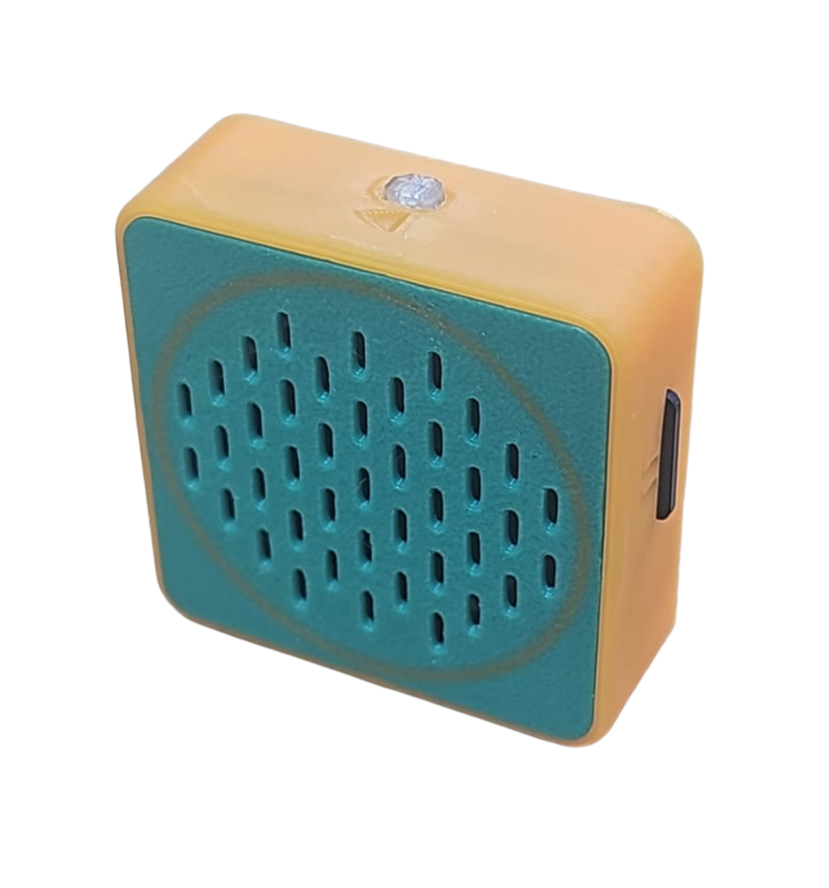

# MP3播放模組

<figure><figcaption></figcaption></figure>

這是一隻MP3模組。

## 產品特點

1. MP3模組只需要3線，節省引腳資源
2. 支援3V驅動，更適合micro:bit創作環境
3. 兼容樂高結構件，拼砌更直接

## 產品參數

* 工作電壓：3V\~5V
* 儲存空間: 沒有，需要插入SD Card
* 接口：PH2.0
* 類型: Digital 數位模組

## 接線教學

### Robotbit EDU

<figure><figcaption></figcaption></figure>

## MakeCode編程教學

#### 在擴展頁輸入插件網址:

#### [https://github.com/kittenbothk/pxt-ModulePlus](https://github.com/kittenbothk/pxt-ModulePlus)

<figure><figcaption></figcaption></figure>

#### 感應器Plus插件：[https://github.com/kittenbothk/pxt-ModulePlus](https://github.com/kittenbothk/pxt-ModulePlus)

#### 詳細方法

#### [詳細方法](../programmingplatforms/makecode/kittenbotandmakecode.md)

## MP3模組積木塊：

<figure><figcaption></figcaption></figure>

## 參考程式:



[https://makecode.microbit.org/\_3c2LJYihM0rm](https://makecode.microbit.org/_3c2LJYihM0rm)
