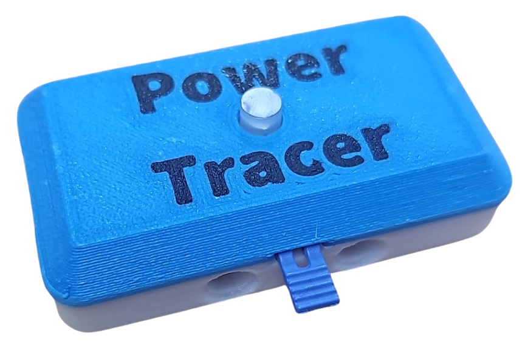
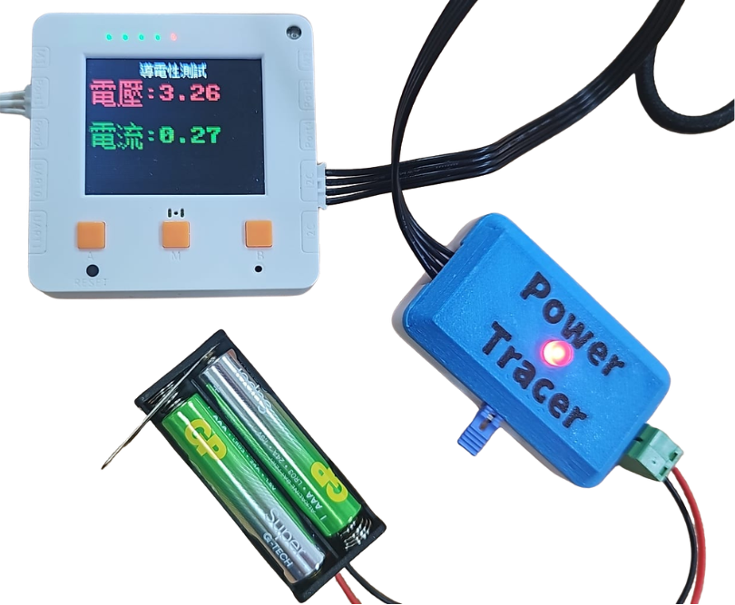

# PowerTracer

<figure><figcaption></figcaption></figure>

這是一隻能夠檢測電流的模組。

## 產品功能

1. 板載LED能夠顯示電源狀態
2. 電源輸入接口可以按接駁不同種類電源
3. 電源輸出接口可以接駁例如LED等小型負載
4. 可以透過編程實時監測電壓及電流數值

## 模組使用示範

<figure><figcaption></figcaption></figure>

## 產品參數

* 工作電壓：3V\~5V
* 類型: I2C模組

## 接線教學

### Robotbit EDU

## MicroPython編程教學

## 應用程式驅動庫



## 參考程式

