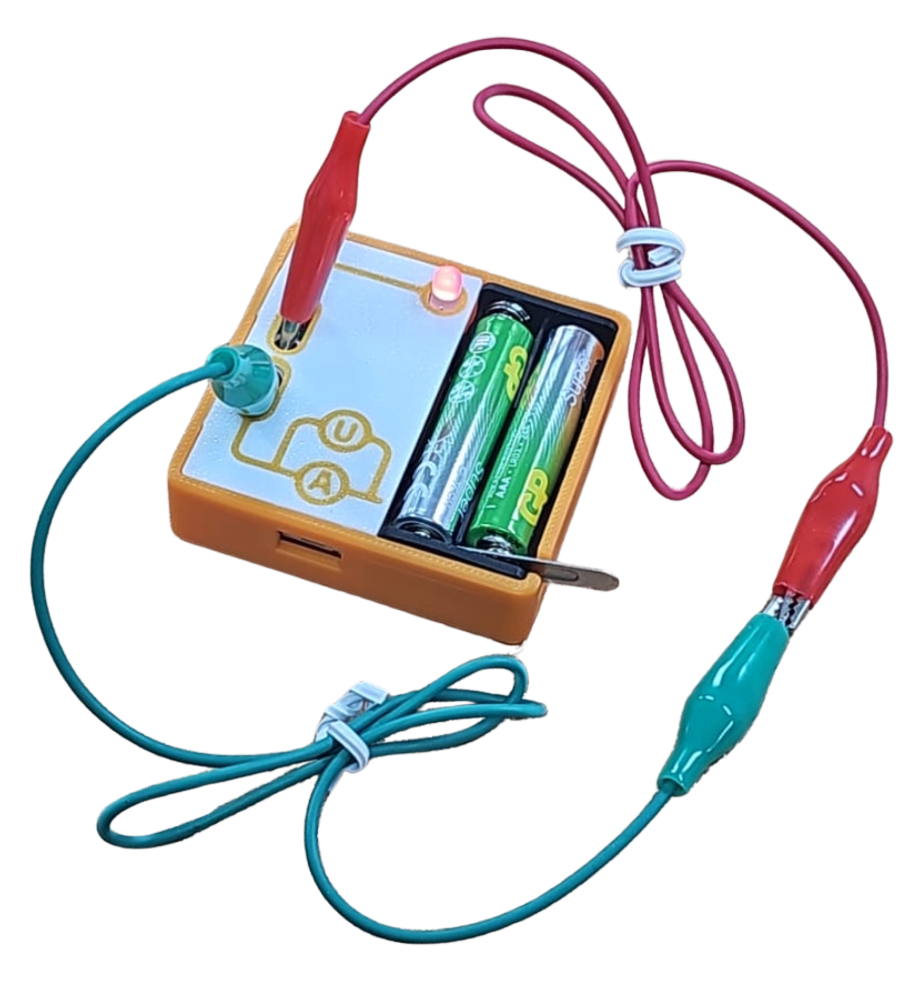
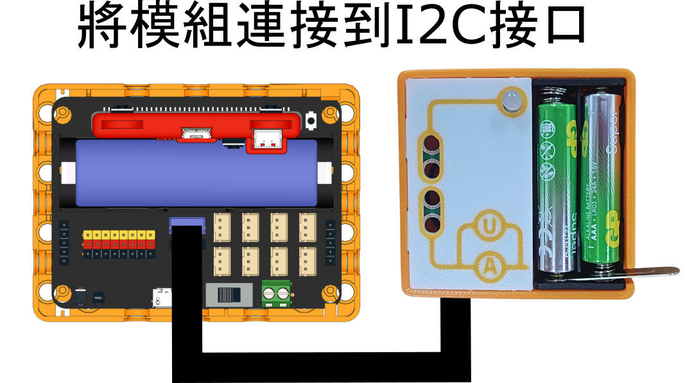
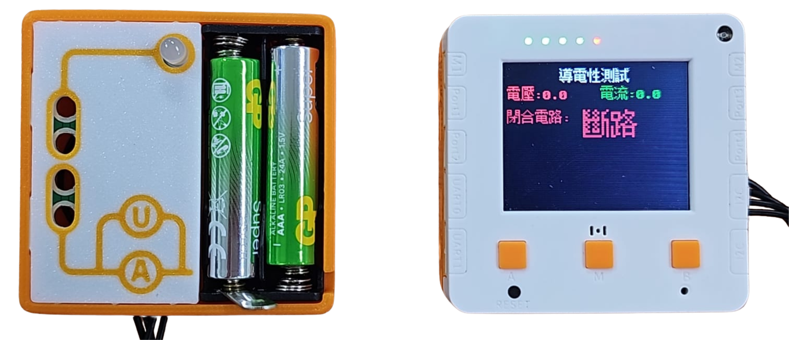
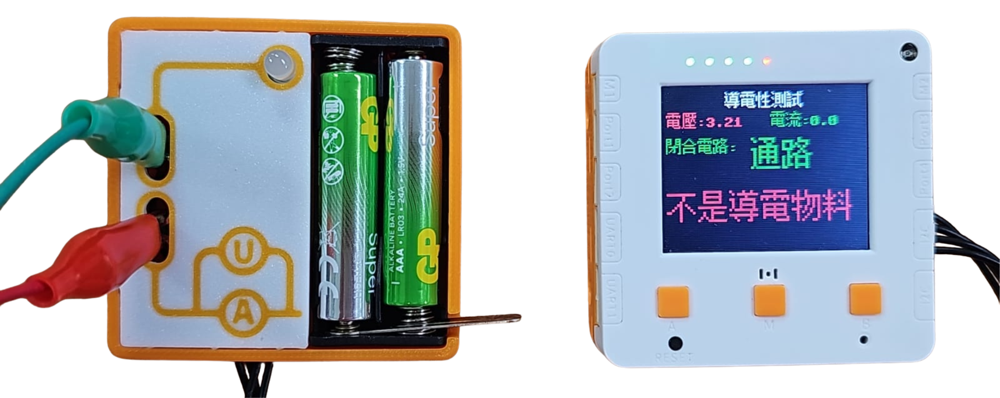
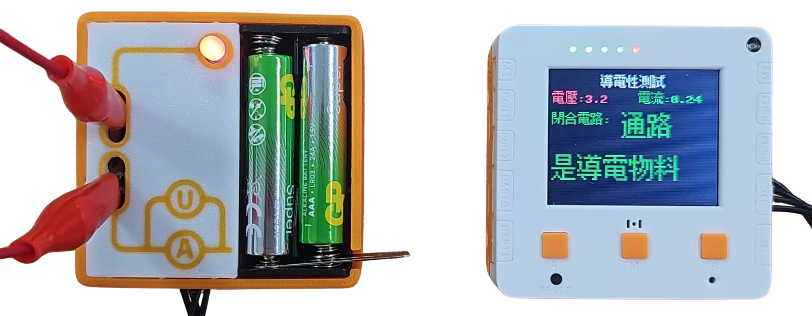

# 導電性檢測 Conductivity

<figure><figcaption></figcaption></figure>

## 硬件接線

<figure><figcaption></figcaption></figure>

## 開啟程式

請同學在未來板Lite上開啟「circuit\_i2c.py」檔案。



## 進行測量

未來板Lite會一直顯示測量到電路的閉合狀態和物料的導電性。

### 斷路

<figure><figcaption></figcaption></figure>

### 非導電物料

<figure><figcaption></figcaption></figure>

### 導電物料

<figure><figcaption></figcaption></figure>

