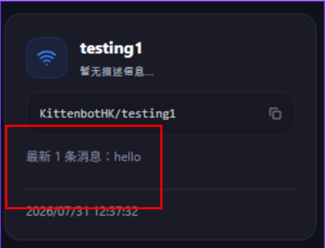

# KOI 2與Kzone編程教學

## 建立帳戶

首先前往Kzone網站開設一個免費的帳戶。

[https://kzone2.kittenbot.cc](https://kzone2.kittenbot.cc)



按Sign Up Free或Start Free，建立免費帳號。

<figure><figcaption></figcaption></figure>

我們可以用Google帳號登入，點擊Google登入然後登入到您的Google帳號。

<figure><figcaption></figcaption></figure>

登入後可以看到Kzone提供很多功能，我們會打開IoT Dashboard。

開啟物聯網平台。

<figure><figcaption></figcaption></figure>

## 設定平台

在IoT Studio主介面點擊My Topics，打開話題列表，我們可以在這裡管理頻道。

<figure><figcaption></figcaption></figure>

第一次進入平台時需要輸入username，之後所有話題都會利用這個Username

<figure><figcaption></figcaption></figure>

## 建立話題

點擊右上角的New Topic，建立新的頻道。

<figure><figcaption></figcaption></figure>

輸入名稱和頻道ID，完成後可以看到剛建立的頻道。

點擊複制鍵可以複製頻道ID。

<figure><figcaption></figcaption></figure>

## 參考程式



[參考程式](https://makecode.microbit.org/_MUv68acd8bDX)

#### 參考程式使用方法

1.填入WiFi登入資料及話題資料

<figure><figcaption></figcaption></figure>

2.打開電源等待KOI開機

3.按下A鍵，將hello信息發送到Kzone平台

<figure><figcaption></figcaption></figure>

4.按下B鍵，將隨機數字發送到Kzone平台

<figure><figcaption></figcaption></figure>

## 建立儀表板

打開可視化面板然後新建項目。

<figure><figcaption></figcaption></figure>

左邊的組件庫有不同的模塊可以使用，可以將想要的模塊拖曳並添加到面板。

<figure><figcaption></figcaption></figure>

點擊模塊可以修改MQTT話題等資訊，輸入要訂閱的話題。

<figure><figcaption></figcaption></figure>

完成設計面板後在左上方按運行。

<figure><figcaption></figcaption></figure>

向該話題發送訊息，儀錶板就會即時作出反應。

<figure><figcaption></figcaption></figure>
